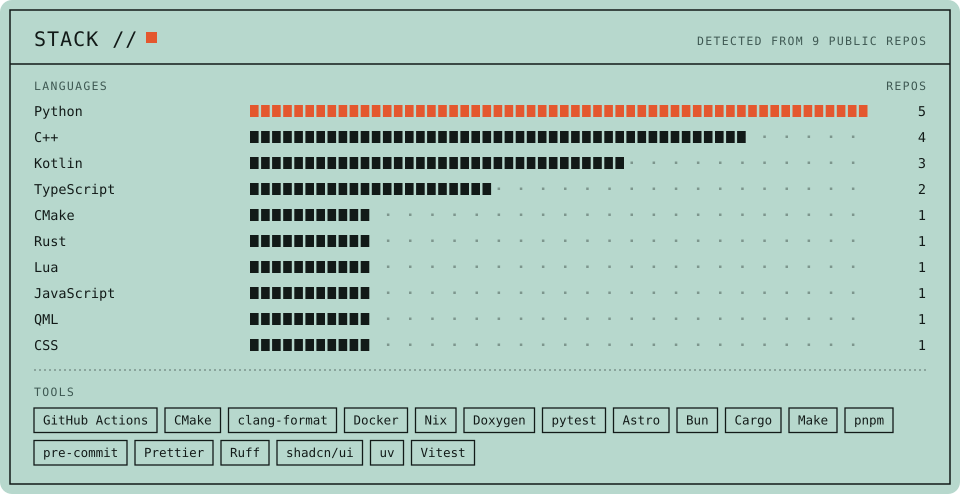
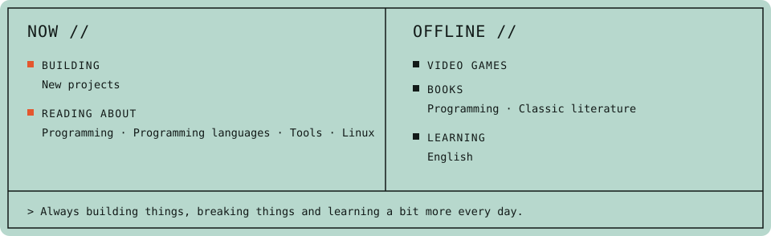
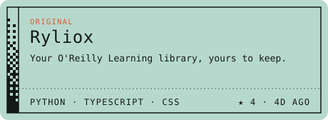
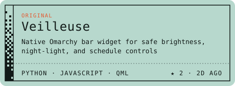
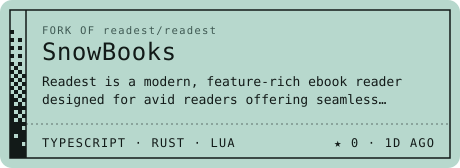
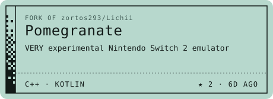
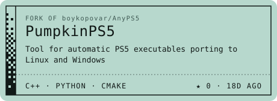
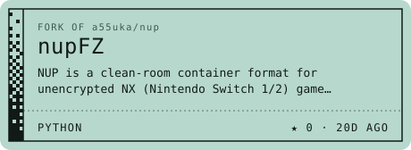
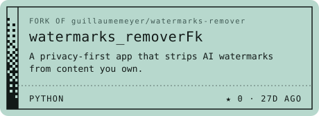

<!-- generated by scripts/build.py; edit PROFILE / NOW / OFFLINE there, not here -->

### Repositories

2 original · 7 forks · originals first, newest push first

<table>
  <tr>
    <td width="50%"></td>
    <td width="50%"></td>
  </tr>
  <tr>
    <td width="50%"></td>
    <td width="50%"></td>
  </tr>
  <tr>
    <td width="50%"></td>
    <td width="50%"></td>
  </tr>
  <tr>
    <td width="50%"></td>
    <td width="50%"></td>
  </tr>
  <tr>
    <td width="50%"></td>
    <td width="50%"></td>
  </tr>
</table>

Everything above is generated by <a href="scripts/build.py"><code>scripts/build.py</code></a> from live GitHub data and refreshed every hour, so new repositories and forks show up on their own. Font: JetBrains Mono (OFL).
