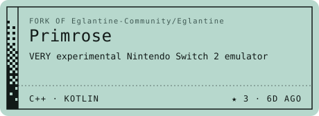
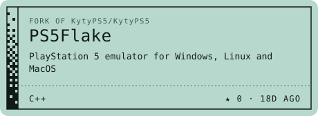

<a href="https://github.com/ZnOw01">
  
</a>

```
> whoami
pumpkin. i take consoles apart in software and put them back together on linux.
```

### Projects

<table>
  <tr>
    <td width="50%"><a href="https://github.com/ZnOw01/Primrose"></a></td>
    <td width="50%"><a href="https://github.com/ZnOw01/Pomegranate"></a></td>
  </tr>
  <tr>
    <td width="50%"><a href="https://github.com/ZnOw01/Ryliox"></a></td>
    <td width="50%"><a href="https://github.com/ZnOw01/Veilleuse"></a></td>
  </tr>
  <tr>
    <td width="50%"><a href="https://github.com/ZnOw01/nupFZ"></a></td>
    <td width="50%"><a href="https://github.com/ZnOw01/PS5Flake"></a></td>
  </tr>
</table>

<sub>Cards are SVGs built by <a href="scripts/build.py"><code>scripts/build.py</code></a> from live GitHub data and refreshed every day by a workflow. Fonts: JetBrains Mono (OFL).</sub>
